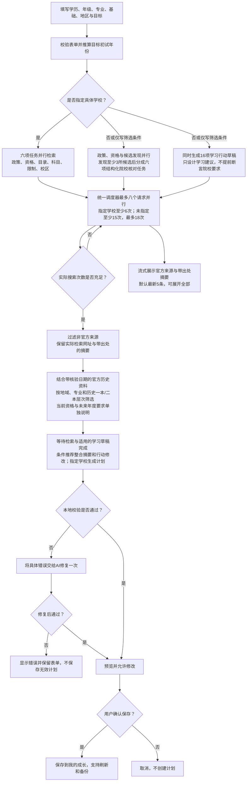

# 升学规划 AI 流程

当前流程在未指定具体学校时逐校核验并推荐三所不同院校；完整结构校验接口仍兼容3–5所。其他校验要求包括：推荐所在地符合用户的城市或省份；历史层次附适用年度、省份及官方依据；所有引用属于本轮实际检索的官方来源或注明核验日期的官方历史参考资料；正文不包含内部变量、代码或 JSON 片段；任务覆盖全部规划学年。数量不足的说明不能代替推荐名单。

一本/二本作为批次取消前的历史招生层次参考，不代表当前硕士招生等级。目标年度尚未公布的资格、科目和日期明确标为待核实或暂定。

实现与完整提示词在 `project/js/ai.js` 的 `generate()` 中；结果校验在 `parsePlan()` 中，保存校验在 `project/js/storage.js` 中。

候选发现只提供待核对名单，最终推荐仍须逐校核验。返回链接必须来自本轮搜索；模型改写网址时，可以通过唯一匹配的官方网页标题解析回原始链接。济南历史一本筛选优先使用已核验的官方历史资料库线索，发现任务仍联网执行并保留其他候选；明确标注核验日期及“不是本轮搜索结果”，不以历史资料认定当前专业或培养校区。每校分别核对专业与报考要求、校区与历史层次，各任务至少两次不同问题的搜索。任务共用18次总预算，发出请求前预留额度，工具结果返回后结算；被服务端 `max_uses_exceeded` 拒绝的调用不计为实际搜索，空结果但正常执行的查询计入搜索次数。官方域名中的论坛页也排除在证据之外。

搜索使用 Fetch SSE，兼容普通JSON。完整官方结果块一返回就发布来源，完整文本块通过出处过滤后发布摘要；不展示模型思考内容。每个任务有独立续查对话，`pause_turn` 保留原始响应块。取消、关闭弹窗、超时或无法完成任务时停止全部请求，并保留真实失败原因与已有资料。

初试年份与招生入学年度相差一年，搜索提示词明确区分；未来年度未发布时查最新已公布资料，不能将旧政策说成未来政策。检索继续使用配置中的高思考强度，计划生成及一次校验修复使用 `low` 思考强度，保持非流式完整预览。

未指定院校时，学习草稿请求和全部检索请求共享八个并发槽位；草稿不计搜索次数。草稿只接收学历、年级、专业、基础与学制推算，不接收尚未核实的院校要求。检索只接收学历、专业、目标年份及筛选条件，避免重复发送学习基础与整份规划资料。指定院校继续沿用原来的六项检索及紧凑计划生成。

每校专业任务输出 `{name, reason, sourceUrl, facts}`，事实包含 `kind`（program/requirements/subjects）、实际资料适用 `year`、中文 `text`、本任务实际返回的 `sourceUrl`。至少包含专业和报考要求两类事实。校区任务输出 `{name, location, criteriaEvidence}`，沿用现有推荐字段。完整JSON解析、任务名称与来源匹配、所在地及历史层次检查通过后，才发布中文摘要；结构错误在剩余搜索预算内补查，未知结束状态不能作为成功。官方历史线索只能支持历史层次，不能作为实际培养校区出处。

程序按候选顺序合并三校结果，并先经过原有完整计划校验，再请求最终整合。每条来源分配 `S1` 等稳定编号；整合输入只包含个人资料、政策与资格摘要、已核验院校与专业事实、学习行动草稿及实际使用的来源表。最终模型仅返回 `title`、`goal`、`summary`、`recommendationNotice`、`dateStatus`、`examDate`、`examSourceId`、`taskEdits`。每条修改为 `{index, title}`，编号0–15且不重复，无需修改时为空数组；不能替换院校名单或来源表。缺失修改数组、越界、重复、内部代码及错误日期均进入一次最终修复流程。

程序将修订后的16项行动均分四个固定阶段，基于正式初试日期或本地暂定考试季日期安排至前一天，再执行完整校验。界面分别显示资料检索、学习行动草稿和最终整合进度，全部完成后统一预览；生成等待期间隐藏“使用原始模板”。任何失败、取消或超时都停止全部请求，保留表单及已展示的官方资料，不自动保存；失败后恢复表单与模板入口。

还原后继续执行完整来源、地域、历史层次、中文正文及日期覆盖校验，保存结构与旧计划、导入导出保持一致。原 `parsePlan` 完整结构接口也继续兼容，紧凑模型结构支持12、16、20或24项任务。本轮保持15次搜索下限、18次上限和现有超时，仅将共享请求并发上限调整为8。

真实测速、成功与失败记录以及前后耗时比较见 [ai-performance.md](ai-performance.md)。普通测试不调用付费接口。
