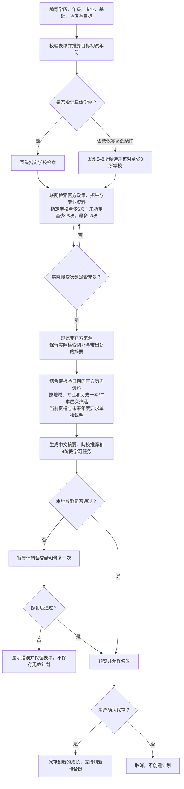

# 升学规划 AI 流程

校验要求包括：未指定具体学校时推荐3–5所不同院校；推荐所在地符合用户的城市或省份；历史层次附适用年度、省份及官方依据；所有引用属于本轮实际检索的官方来源或注明核验日期的官方历史参考资料；正文不包含内部变量、代码或 JSON 片段；任务覆盖全部规划学年。数量不足的说明不能代替推荐名单。

一本/二本作为批次取消前的历史招生层次参考，不代表当前硕士招生等级。目标年度尚未公布的资格、科目和日期明确标为待核实或暂定。

实现与完整提示词在 `project/js/ai.js` 的 `generate()` 中；结果校验在 `parsePlan()` 中，保存校验在 `project/js/storage.js` 中。
